# Screens

The running console, captured by the Playwright demo tour
([`e2e/tests/06-demo-walkthrough.spec.js`](../e2e/tests/06-demo-walkthrough.spec.js)) against the
full stack with `database/seed.sql` loaded. Main Entrance is the one live camera: the people
detector counts a crowd clip on the GPU, over its limit of 15.

`./e2e/run.sh` writes a fresh set here on every run.

**Video:** [`videos/walkthrough.webm`](videos/walkthrough.webm), the whole tour as admin and then
as a viewer.

## Signing in

| | |
|---|---|
|  | 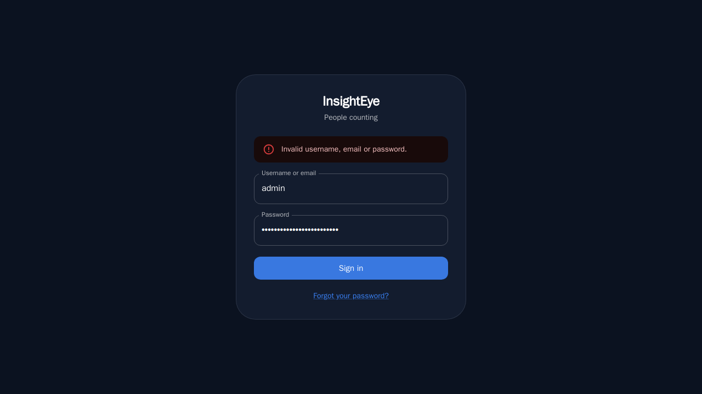 |
| Login | A wrong password |

## As admin

**Dashboard:** live occupancy per camera against its limits, and the latest alerts.

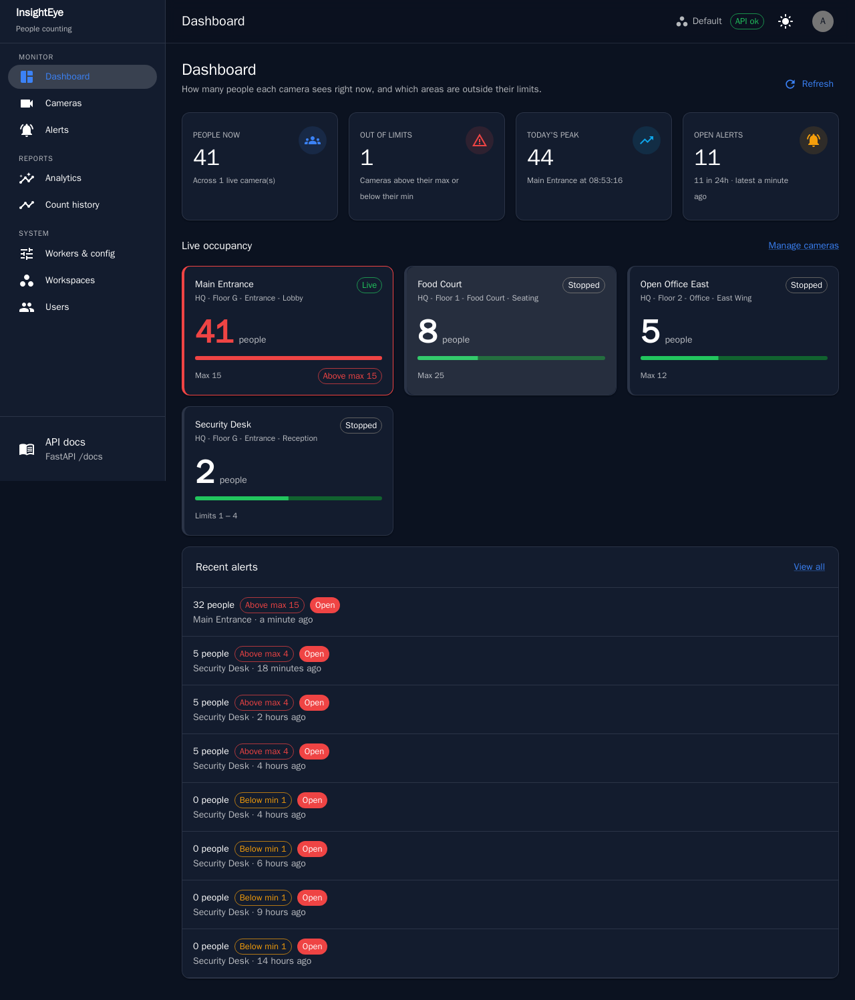

**Cameras** and a camera's **live view**: every counted person boxed, the frame red while the
count is over the limit, and the next alert held back by the cooldown.

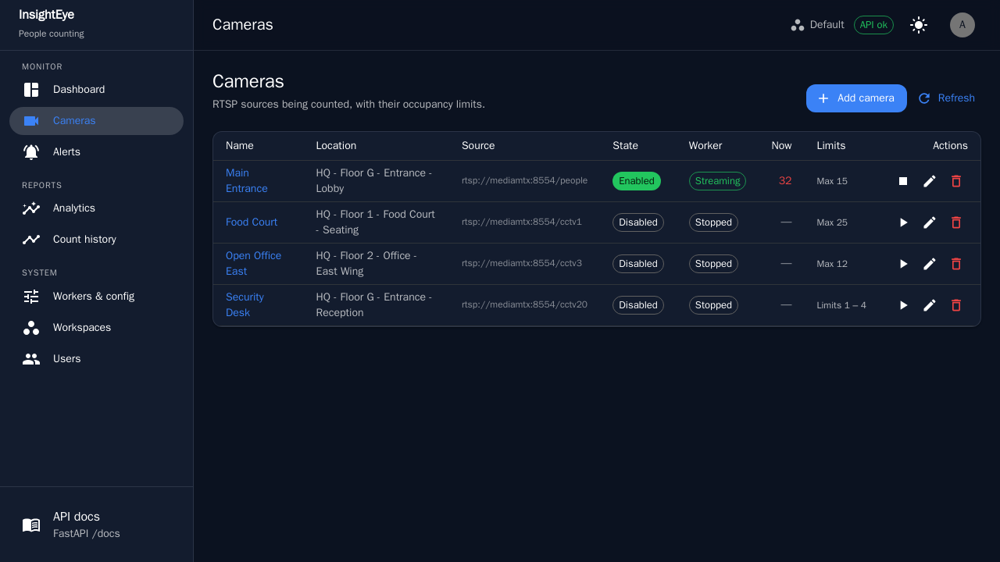
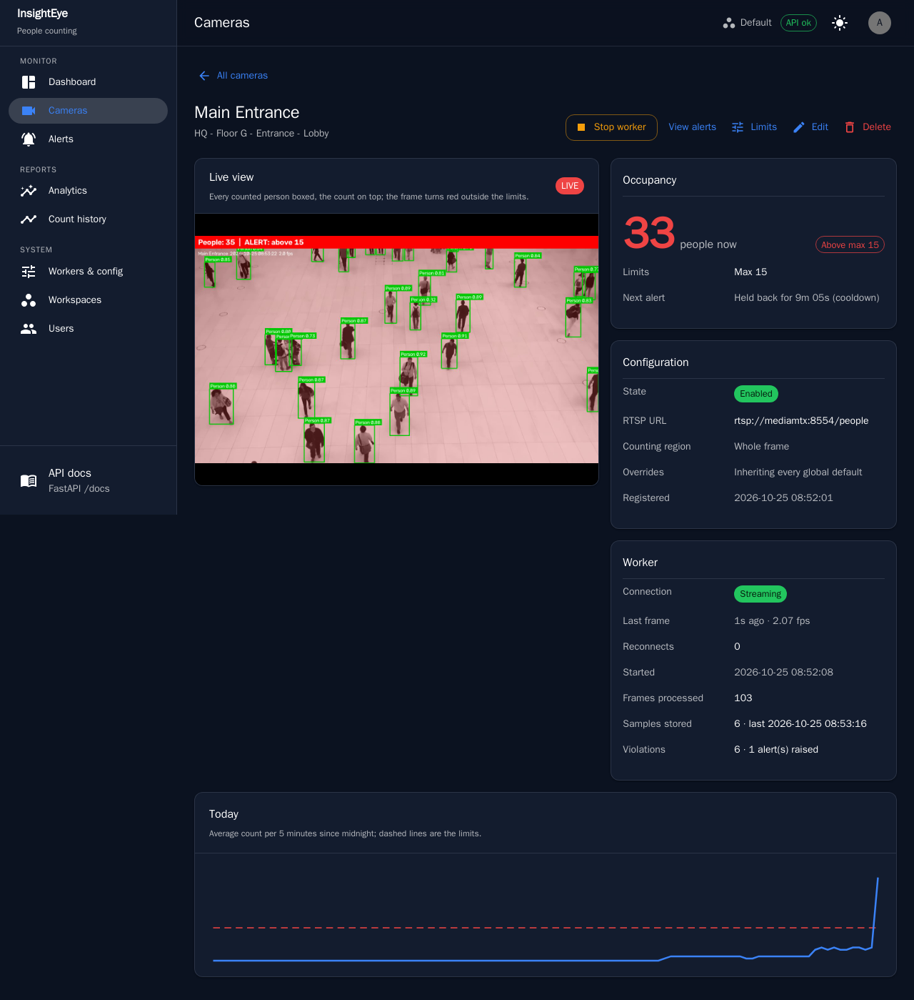

**Alerts** and an **alert** with the annotated snapshot that raised it.

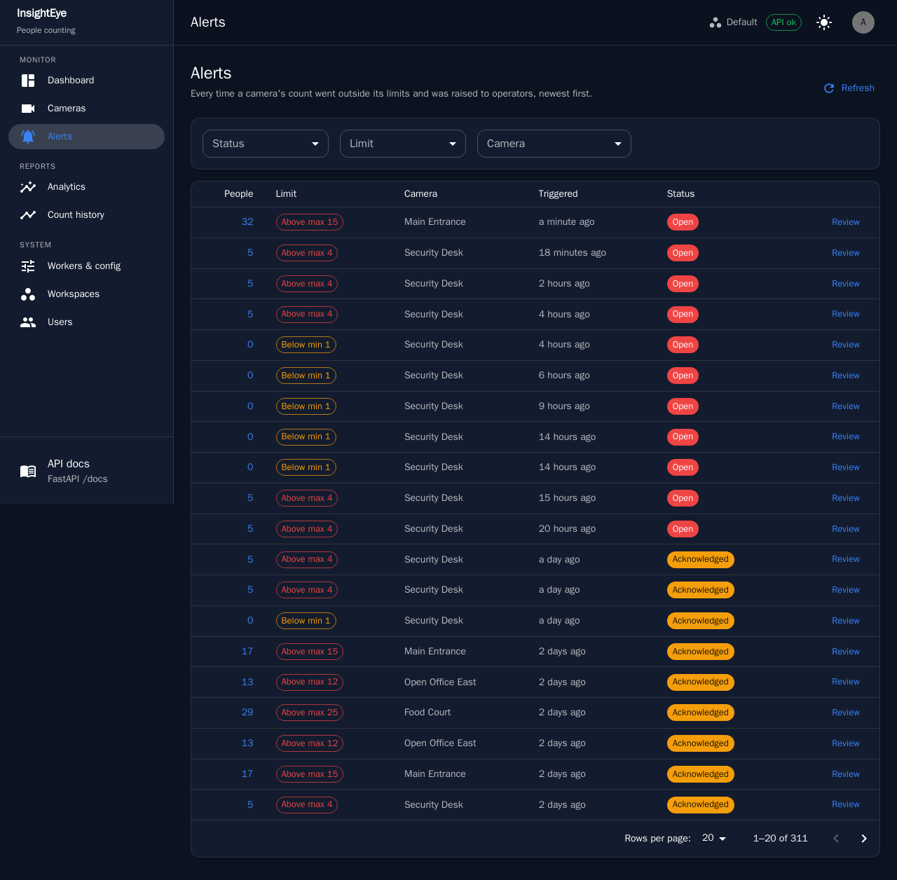
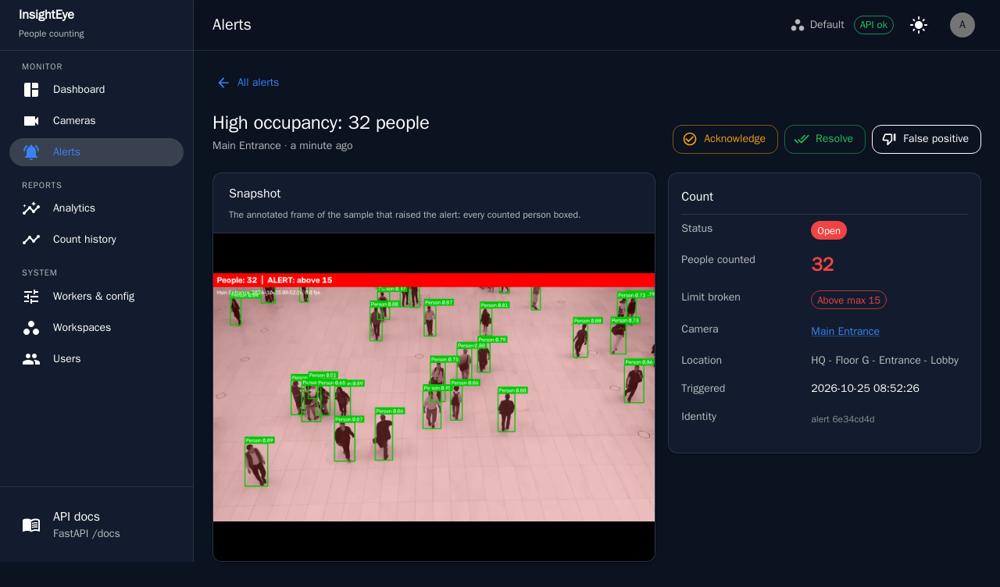

**Analytics:** occupancy over time, per camera, per floor, by weekday and hour, and threshold
violations.

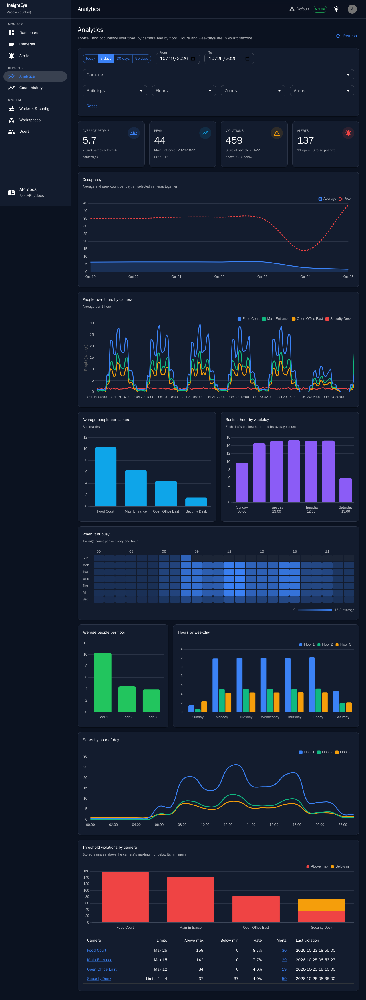

**Count history:** every stored sample, filterable and exportable as CSV.

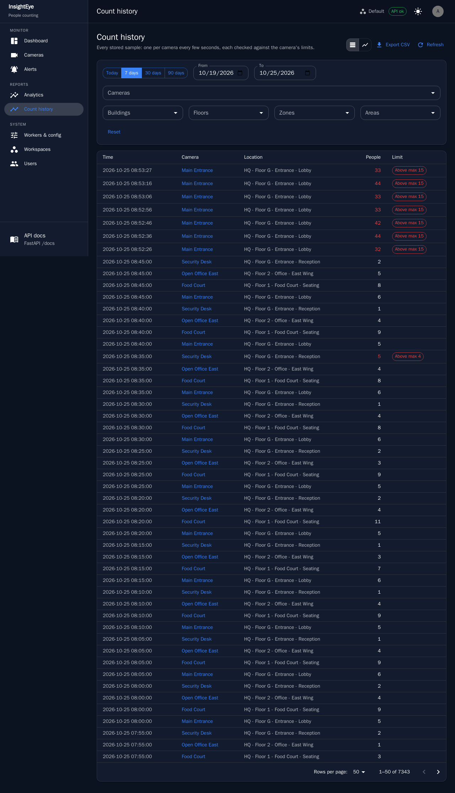

**Workers & config:** the running workers and the counting values in force.

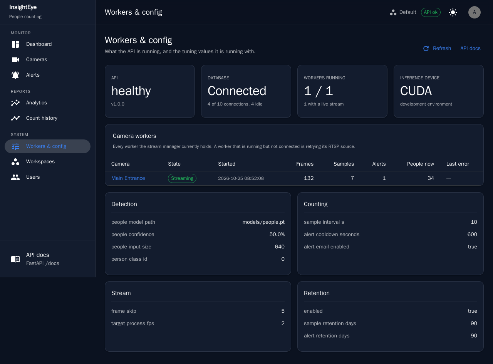

**Users**, and the account menu.

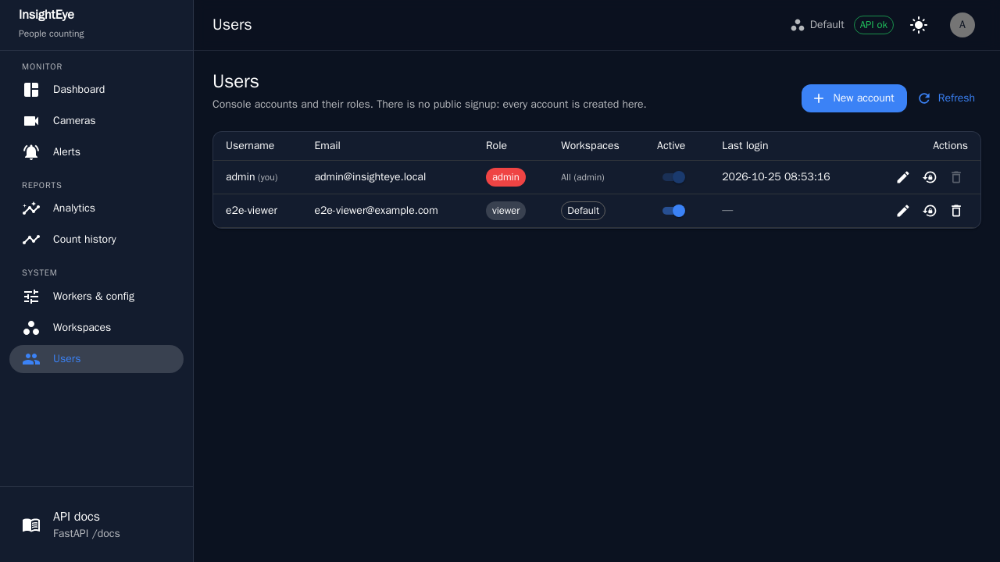
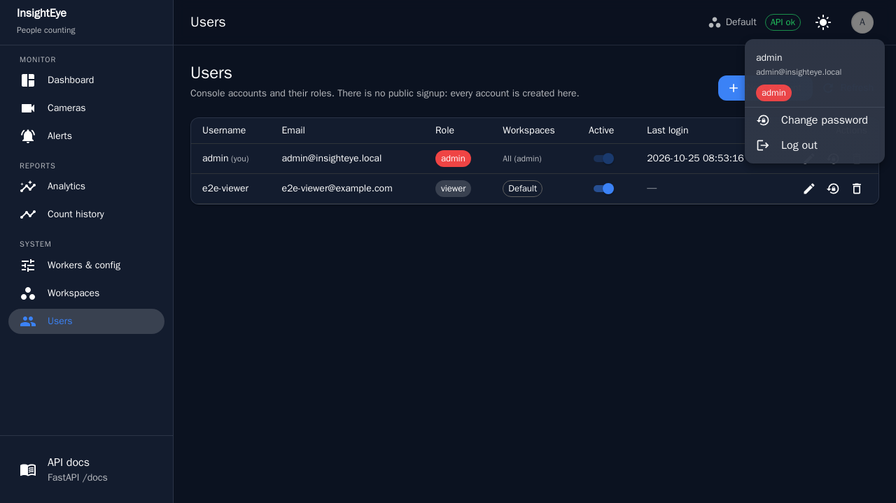

## As a viewer

Read-only: no Users or Workspaces pages, and no camera actions.

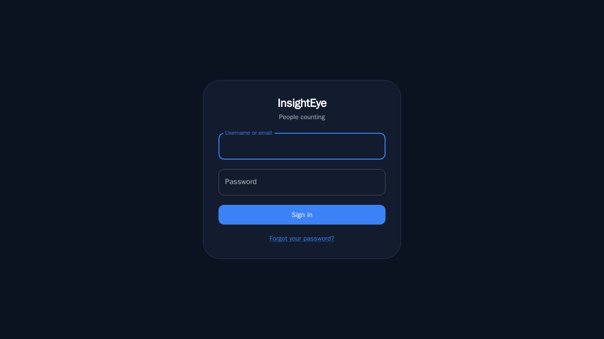
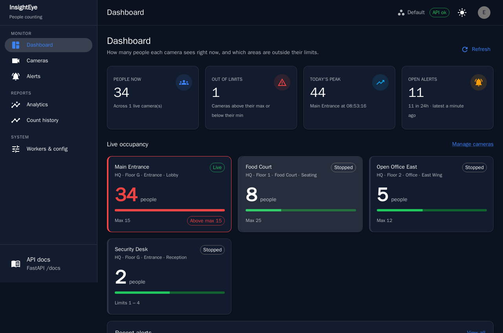
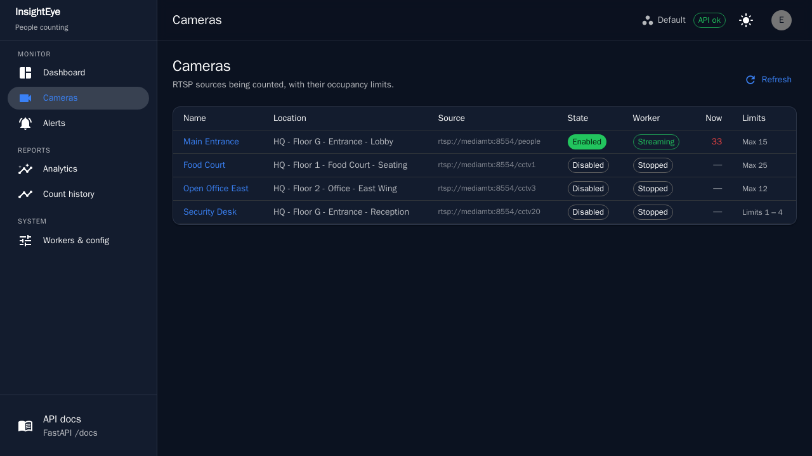
